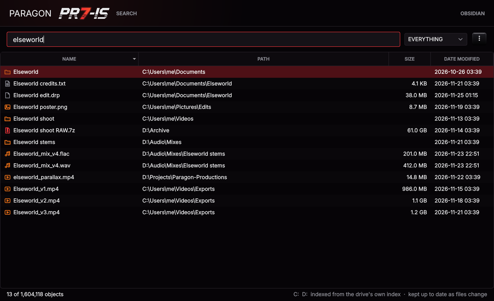
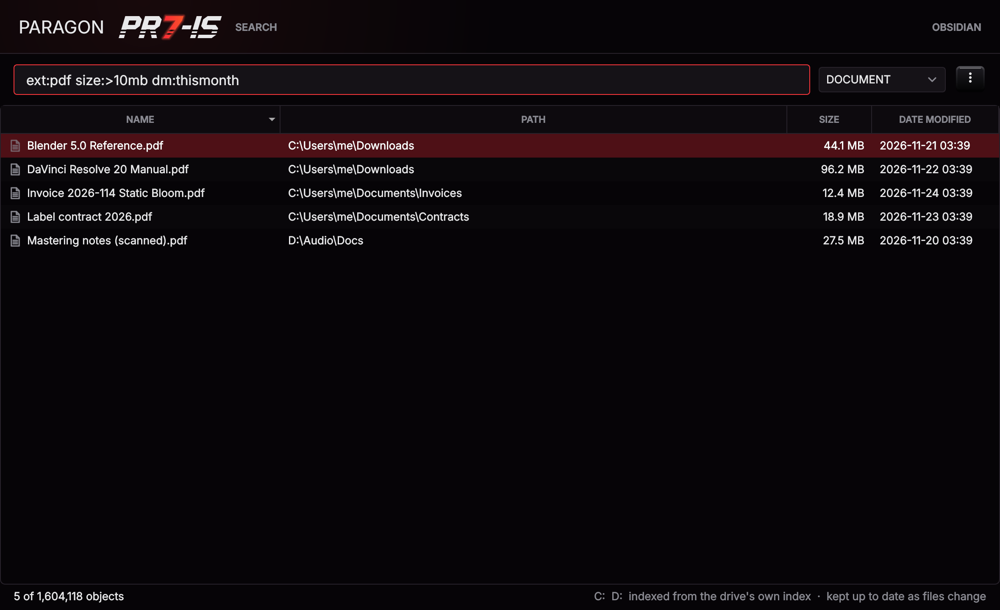

# Paragon PR7-IS

Instant file search that works the way **Everything** works, in the Paragon family look (PR7-Z, PR7-W, PR7-L, PR7-F,
PR7-E, PR7-R, PR7-P, PR7-M, PR7-Q, PR7-U, PR7-DU, PR7-CB). Python and PySide6.

## What it does

- Finds files and folders by name **as you type**, across every file on your drives, in a few hundredths of a second.
- **The index service** reads each NTFS drive's own index (the MFT) in seconds, the way Everything does, and then
  keeps up with every change through the drive's change journal: a new, renamed, moved or deleted file shows up
  (or goes) within a second. Reading the MFT needs administrator rights, so the service is a small scheduled task
  that Windows asks about **once**, when it's installed; after that, searching never asks again.
- Without the service (or on exFAT / FAT drives) the folders are walked instead: slower to build, same search.
- Search syntax: every word must be in the name (any case); `a|b` either; `!word` not; `*` and `?` wildcards;
  a word with `\` matches the path; `ext:pdf;docx`, `size:>10mb` (`<`, `>=`, `a..b`, `empty`, `tiny` ... `gigantic`),
  `dm:today` / `yesterday` / `thisweek` / `lastweek` / `thismonth` / `thisyear` / `2026-11-01..2026-11-25`,
  `file:`, `folder:`, and "quoted words with spaces". The filter list adds Audio, Compressed, Document, Executable,
  Picture, Video or Folder.
- Enter opens, Ctrl+Enter / the menu opens the folder (in PR7-E when it's installed), copy full path or name; sort by
  any column.
- **Ctrl+Alt+Space** brings it up from anywhere; it can start with Windows in the notification area.
- Options: the drives, things to leave out (`C:\Windows\WinSxS`, `*.tmp`, `$Recycle.Bin` to begin with), the key,
  install / remove the service, rebuild the index.

## Building

`pip install -r requirements-dev.txt`, `python -m pytest`, `pyinstaller pr7is.spec`, then Inno Setup 6 on
`installer/pr7is.iss`. CI does all of it on Windows (and checks the installed service reads the runner's drive
through its MFT and sees a new file through the change journal); a pushed new version publishes itself.
